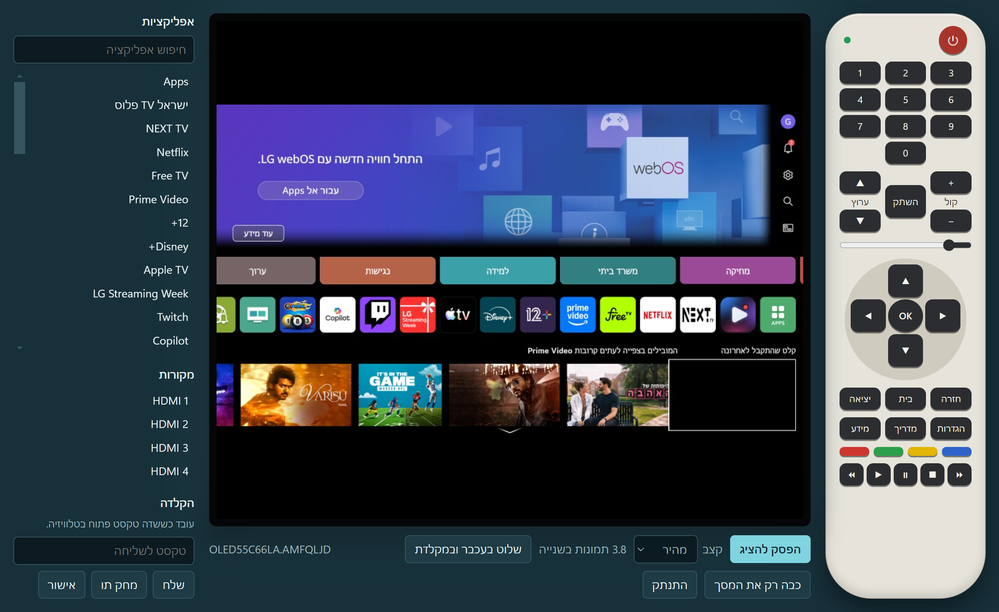
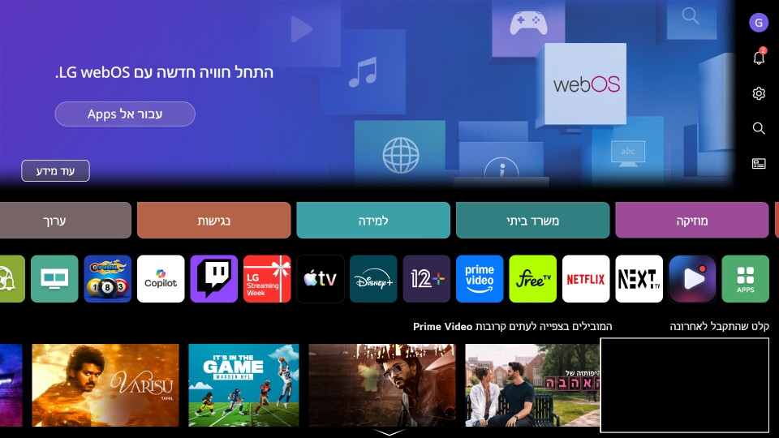

# Universal TV Remote

[English](README.md) | **עברית**

אפליקציית Windows לשליטה בטלוויזיה החכמה שלך מהמחשב: LG, Samsung, Android TV ו-Google TV (Sony, Philips, TCL, Xiaomi ועוד), Roku, Vizio ו-Sony BRAVIA. יש בה שלט על המסך, אפליקציות, מקורות, הקלדה ועוצמת קול. בטלוויזיות LG היא גם מציגה את מסך הטלוויזיה ושולטת בסמן עכבר.

> **רק LG נבדקה על טלוויזיה אמיתית.** שאר המותגים נכתבו לפי הפרוטוקולים שפורסמו ונבדקו מול סימולטורים, ולכן ייתכן שיצטרכו תיקונים על טלוויזיה אמיתית. ראה [אילו טלוויזיות עובדות](#אילו-טלוויזיות-עובדות).



*האפליקציה מציגה את מסך הבית של LG OLED55C6 אמיתית.*

לא מתקינים כלום על הטלוויזיה, ולא צריך Developer Mode או root.

האפליקציה זמינה בעברית ובאנגלית. הפרטים הטכניים נמצאים ב[איך זה עובד](docs/HOW-IT-WORKS.md).

## תוכן עניינים

- [התקנה מהירה](#התקנה-מהירה)
- [אילו טלוויזיות עובדות](#אילו-טלוויזיות-עובדות)
- [מה זה עושה ומה לא ב-LG](#מה-זה-עושה-ומה-לא-ב-lg)
- [דרישות](#דרישות)
- [התקנה](#התקנה)
- [חיבור בפעם הראשונה](#חיבור-בפעם-הראשונה)
- [בחירת שפה](#בחירת-שפה)
- [שימוש באפליקציה](#שימוש-באפליקציה)
- [הדלקת הטלוויזיה דרך הרשת](#הדלקת-הטלוויזיה-דרך-הרשת)
- [שליטה מחוץ לבית](#שליטה-מחוץ-לבית)
- [מה נבדק](#מה-נבדק)
- [פתרון בעיות](#פתרון-בעיות)
- [שאלות נפוצות](#שאלות-נפוצות)
- [פרטיות ואבטחה](#פרטיות-ואבטחה)
- [פיתוח](#פיתוח)

## התקנה מהירה

מריצים ב-PowerShell:

```powershell
irm https://raw.githubusercontent.com/dor2500/universal-tv-remote/main/install.ps1 | iex
```

הפקודה מתקינה את הגרסה האחרונה למשתמש שלך, מוסיפה קיצור דרך לתפריט התחל ופותחת את האפליקציה. לא צריך הרשאות מנהל.

## אילו טלוויזיות עובדות

אף אפליקציה לא יכולה לשלוט בכל טלוויזיה דרך הרשת. האפליקציה עובדת עם הפלטפורמות שבטבלה, ומציגה רק את הכפתורים והחלקים שהטלוויזיה שלך תומכת בהם.

| | LG webOS | Samsung Tizen | Android TV / Google TV | Roku | Vizio SmartCast | Sony BRAVIA (מפתח) |
|---|---|---|---|---|---|---|
| נמכר למשל אצל | LG | Samsung, מ-2016 והלאה | Sony, Philips, TCL, Hisense, Xiaomi | TCL, Hisense, Sharp, נגני Roku | Vizio | Sony |
| חיבור ראשון | אישור בטלוויזיה | אישור בטלוויזיה | הקלדת הקוד מהטלוויזיה | כלום | הקלדת הקוד מהטלוויזיה | הגדרת מפתח בטלוויזיה והקלדתו |
| כפתורי שלט | כולם | כולם | רובם | בלי ספרות וצבעים | בלי ספרות וצבעים | אלה שהטלוויזיה מדווחת |
| אפליקציות | רשימת המותקנות | רשימת המותקנות | 7 אפליקציות נפוצות | רשימת המותקנות | לא | רשימת המותקנות |
| מקורות | כן | HDMI 1–4 | HDMI 1–4 | בטלוויזיות Roku | כן | כן |
| הקלדה | כן | כן | כן | כן, אות אחר אות | לא | כן |
| סרגל עוצמת קול | כן | לא, רק + ו-− | לא, רק + ו-− | לא, רק + ו-− | כן | כן |
| כיבוי | כן | כן | כן (מתג הפעלה) | בטלוויזיות Roku | כן | כן |
| **צפייה במסך באפליקציה** | **כן** | לא | לא | לא | לא | לא |
| **סמן עכבר** | **כן** | לא | לא | לא | לא | לא |
| נבדק על טלוויזיה אמיתית | **כן, דגם אחד** | לא | לא | לא | לא | לא |

**לא נתמך:**

- **טלוויזיות בלי חיבור לרשת:** המחשב לא יכול להגיע אליהן. הן דורשות חומרה נוספת, כמו משדר אינפרה-אדום, והאפליקציה לא תומכת בה.
- **פלטפורמות אחרות:** Samsung מלפני 2016, Hisense VIDAA, Panasonic, Fire TV, Philips בלי Android ועוד. האפליקציה תודיע שלא נמצאה טלוויזיה נתמכת.

**למה רק ב-LG רואים את המסך:** ל-webOS יש פקודת צילום מסך שעובדת בלי לשנות דבר בטלוויזיה. בפלטפורמות האחרות אין פקודה כזו בפרוטוקולים האלה.

## מה זה עושה ומה לא ב-LG

ב-LG האפליקציה מתקרבת ל-AnyDesk, אבל ל-webOS יש מגבלות אמיתיות.

| יכולת | מצב |
|---|---|
| כל כפתורי השלט | כן |
| סמן עכבר, קליק וגלילה בטלוויזיה | כן |
| הקלדה בשדה טקסט פתוח, כולל עברית | כן |
| פתיחת אפליקציות והחלפת מקורות | כן |
| עוצמת קול, השתקה, כיבוי הטלוויזיה, כיבוי המסך בלבד | כן |
| הדלקת הטלוויזיה | רק מהרשת הביתית, ואחרי הפעלת הגדרה בטלוויזיה |
| צפייה במסך | כן, בצילומים חוזרים ב-960×540, כ-3 בשנייה |
| וידאו חי וחלק | לא: ל-webOS יש צילומי מסך, לא זרם וידאו |
| קול במחשב | לא |
| לחיצה על נקודה מדויקת בתמונה | לא: הטלוויזיה מקבלת רק תנועה יחסית של הסמן |
| תוכן מוגן כמו Netflix | עלול להופיע שחור (עוד לא נבדק) |

LG לא מתעדים רשמית את הפרוטוקול שהאפליקציה משתמשת בו, ולכן עדכון קושחה עלול לשנות את ההתנהגות.

## דרישות

- Windows 10 או 11, בגרסת 64 ביט.
- טלוויזיה מ[הרשימה הנתמכת](#אילו-טלוויזיות-עובדות).
- מחשב וטלוויזיה באותה רשת, או מחוברים דרך VPN.
- השלט הרגיל של הטלוויזיה, לחיבור הראשון. Roku היא היוצאת מהכלל.

## התקנה

### אפשרות 1: פקודת PowerShell (מומלץ)

```powershell
irm https://raw.githubusercontent.com/dor2500/universal-tv-remote/main/install.ps1 | iex
```

הפקודה:

1. מוצאת ב-GitHub את הגרסה האחרונה.
2. מורידה את האפליקציה ובודקת את גודל הקובץ, וגם את ה-checksum כש-GitHub מספק אותו.
3. שומרת אותה ב-`%LOCALAPPDATA%\Programs\Universal TV Remote`.
4. מוסיפה קיצור דרך בשם "Universal TV Remote" לתפריט התחל.
5. פותחת את האפליקציה.

לעדכון מריצים את אותה פקודה שוב, אחרי שסוגרים את האפליקציה. היא גם מחליפה גרסה שהותקנה בשם הישן, LG TV Remote, ושומרת על הטלוויזיות השמורות. אפשר [לקרוא את הסקריפט](install.ps1) לפני ההרצה.

### אפשרות 2: הורדת הקובץ

1. פתח את [הגרסה האחרונה](https://github.com/dor2500/universal-tv-remote/releases/latest).
2. הורד את `Universal.TV.Remote.0.2.0.exe`.
3. הפעל אותו. לא צריך התקנה.

הקובץ לא חתום, ולכן Windows עלול להציג אזהרה. כדי להמשיך, בחר "מידע נוסף" ואז "הפעל בכל זאת".

### אפשרות 3: הרצה מהקוד

צריך [Node.js](https://nodejs.org) ו-[Git](https://git-scm.com).

```bash
git clone https://github.com/dor2500/universal-tv-remote.git
```

```bash
cd universal-tv-remote
```

```bash
npm install
```

```bash
npm start
```

אם האפליקציה מדווחת ש-Electron לא הותקן כראוי (זה קרה ב-Node 26):

1. פרוס את `electron-v33.4.11-win32-x64.zip` מ-`%LOCALAPPDATA%\electron\Cache` אל `node_modules\electron\dist`.
2. צור קובץ `node_modules\electron\path.txt` שתוכנו רק `electron.exe`.

### הסרה

הפקודה הזו מסירה אפליקציה שהותקנה בפקודת ה-PowerShell:

```powershell
Remove-Item -Recurse "$env:LOCALAPPDATA\Programs\Universal TV Remote"; Remove-Item "$([Environment]::GetFolderPath('Programs'))\Universal TV Remote.lnk"
```

כדי למחוק גם טלוויזיות שמורות ומפתחות חיבור, מחק את `%APPDATA%\universal-tv-remote`. אם התקנת קודם גרסה בשם LG TV Remote, הנתונים נמצאים ב-`%APPDATA%\lg-tv-remote`.

## חיבור בפעם הראשונה


1. הדלק את הטלוויזיה וודא שהיא באותה רשת של המחשב.
2. פתח את האפליקציה.
3. בחר "חפש טלוויזיות ברשת" ואז את הטלוויזיה שלך. אפשר גם לכתוב את כתובת ה-IP שלה וללחוץ "התחבר". ב"סוג הטלוויזיה" אפשר להשאיר "זיהוי אוטומטי".
4. השלם את החיבור הראשון לפי הטלוויזיה שלך, כמו בטבלה. יש לך 90 שניות.
5. הנקודה בשלט שבאפליקציה נהיית ירוקה, ומופיע מה שהטלוויזיה מציעה.

| טלוויזיה | חיבור ראשון |
|---|---|
| LG, Samsung | אשר את הבקשה על מסך הטלוויזיה בעזרת השלט הרגיל |
| Android TV, Google TV | הטלוויזיה מציגה קוד בן 6 תווים. כתוב אותו באפליקציה |
| Vizio | הטלוויזיה מציגה קוד. כתוב אותו באפליקציה |
| Roku | אין מה לאשר. אם השליטה נדחית, הפעל את "Control by mobile apps" בהגדרות המערכת המתקדמות |
| Sony BRAVIA, בבחירה "Sony BRAVIA (עם מפתח)" | בטלוויזיה פתח הגדרות > רשת > הגדרות בית > בקרת IP, הגדר אימות "Normal and Pre-Shared Key", בחר מפתח וכתוב אותו באפליקציה. התפריט משתנה לפי דגם |

טלוויזיית Sony עם Android מזוהה כ-Android TV, שלא דורשת הגדרה. כדי לקבל את רשימת האפליקציות המותקנות ואת סרגל עוצמת הקול שלה, בחר ידנית "Sony BRAVIA (עם מפתח)".

בחיבורים הבאים לא צריך אישור.

**איפה מוצאים את הכתובת:** בהגדרות הרשת של הטלוויזיה מופיעה כתובת ה-IP. התפריט המדויק משתנה לפי דגם.

**כדאי לקבע את הכתובת:** שמור לטלוויזיה כתובת IP קבועה בראוטר. אחרת הכתובת השמורה עלולה להפסיק לעבוד כשהראוטר נותן כתובת חדשה.

**אם לא מופיעה בקשה בטלוויזיית LG:** בחר "התחבר עם קוד PIN" וכתוב את הקוד שמופיע בטלוויזיה.

## בחירת שפה

האפליקציה נפתחת בעברית אם Windows מוגדר לעברית, ובאנגלית בכל מצב אחר. כדי להחליף, בחר את שם השפה בראש השלט שעל המסך. האפליקציה זוכרת את הבחירה, והפריסה מתהפכת בהתאם לשפה.

הודעות שהטלוויזיה עצמה כותבת מוצגות כפי שהיא שולחת אותן.

## שימוש באפליקציה


*בתמונה הזו ובתמונה הבאה מופיעה טלוויזיה מדומה.*

### השלט

הטבלה מציגה את כל הכפתורים. בטלוויזיה שלך ייתכן שיוצגו פחות.

| כפתור | מה הוא עושה |
|---|---|
| כפתור ההפעלה האדום | מכבה את הטלוויזיה. כשהאפליקציה מנותקת, מנסה להדליק אותה |
| 0–9 | מקשי מספרים |
| קול + / − | הגברה והנמכה |
| ערוץ ▲ / ▼ | ערוץ הבא וקודם |
| השתק | השתקה וביטול השתקה |
| סרגל | קביעת עוצמת הקול ישירות |
| חיצים ו-OK | ניווט |
| חזרה | חזרה |
| בית | מסך הבית |
| יציאה | יציאה |
| הגדרות | הגדרות מהירות |
| מדריך | מדריך שידורים |
| מידע | מידע |
| כפתורי הצבע | מקשי אדום, ירוק, צהוב וכחול |
| השורה התחתונה | הרצה אחורה, ניגון, השהיה, עצירה, הרצה קדימה |

הכפתורים פועלים על מה שמוצג באותו רגע בטלוויזיה, וכל אפליקציה מחליטה איך להגיב להם.

הנקודה בראש השלט מציגה את מצב החיבור:

- **ירוק:** מחובר.
- **צהוב:** מתחבר, מתחבר מחדש או מחכה לאישור.
- **אפור:** מנותק.

אם החיבור נופל, האפליקציה ממשיכה לנסות להתחבר מחדש, עם המתנה של עד 30 שניות בין ניסיונות.

### צפייה במסך

בטלוויזיות LG בלבד.


"הצג את המסך" מפעיל את התצוגה ו"הפסק להציג" עוצר אותה. בתפריט "קצב" יש שלוש אפשרויות:

| אפשרות | זמן בין צילומים |
|---|---|
| מהיר | 250 מילישניות |
| רגיל | 500 מילישניות |
| חסכוני | 1.5 שניות |

הקצב בפועל מוצג ליד התפריט. הוא לא יכול לעבור את מה שהטלוויזיה מספקת: כ-3–4 תמונות בשנייה בטלוויזיה שנבדקה.

כך נראית התמונה המקורית שהטלוויזיה מחזירה:



### עכבר ומקלדת

בטלוויזיות LG בלבד. בטלוויזיות אחרות השתמש בחיצים ובחלק של ההקלדה.

בחר "שלוט בעכבר ובמקלדת" או לחץ על התמונה. האפליקציה תתפוס את העכבר עד שתלחץ Esc.

| במחשב | בטלוויזיה |
|---|---|
| הזזת העכבר | הזזת הסמן |
| קליק שמאלי | לחיצה |
| קליק ימני | חזרה |
| גלגלת | גלילה |
| חיצים | ניווט |
| Enter | אישור |
| Backspace | מחיקת תו |
| אותיות ומספרים | הקלדה בשדה טקסט פתוח |
| Esc | שחרור העכבר |

**הסמן הלבן על התמונה הוא הערכה.** הטלוויזיה לא כוללת את הסמן שלה בצילומי המסך ולא מדווחת איפה הוא, ולכן האפליקציה מחשבת את המיקום ומציירת סמן משלה.

- **כל לכידה מתחילה מפינה:** הסמן בטלוויזיה קופץ לפינה השמאלית העליונה, וכך לאפליקציה יש נקודת התחלה ידועה.
- **הפריט המודגש הוא המיקום האמיתי:** אם יש פער, סמוך על מה שהטלוויזיה מדגישה.
- **לתיקון סטייה:** לחץ Esc ולכוד מחדש, או הזז את הסמן עד לקצה המסך.

### אפליקציות, מקורות והקלדה

הפאנל הצדדי מופיע אחרי החיבור.

- **אפליקציות:** בחירה פותחת את האפליקציה. שדה החיפוש מסנן לפי שם, והאפליקציה שרצה מסומנת.
- **מקורות:** מעבר בין HDMI ומקורות אחרים.
- **הקלדה:** שליחת שורת טקסט שלמה, מחיקת תו או אישור. שדה טקסט צריך להיות פתוח כבר בטלוויזיה.

### פקדים נוספים

- **כבה רק את המסך** מכבה את התמונה בזמן שהטלוויזיה נשארת דלוקה, למשל בזמן האזנה למוזיקה. **הדלק את המסך** מחזיר אותה.
- **התנתק** מנתק את החיבור.
- **שכח**, ליד טלוויזיה שמורה במסך החיבור, מוחק מהמחשב את הטלוויזיה ואת מפתח החיבור שלה.

## הדלקת הטלוויזיה דרך הרשת

כפתור ההפעלה יכול להעיר את הטלוויזיה בחבילת Wake-on-LAN, בטלוויזיות שמדווחות על כתובת ה-MAC שלהן: LG, Samsung, Roku ו-Sony. לשם כך צריך שלושה דברים:

1. חיבור מוצלח אחד, שבו האפליקציה לומדת את כתובת ה-MAC של הטלוויזיה.
2. הגדרה פעילה בטלוויזיה. ב-LG היא נקראת בדרך כלל "הפעלה דרך Wi-Fi" או "LG Connect Apps". השם משתנה לפי מותג ודגם.
3. מחשב באותה רשת ביתית של הטלוויזיה.

זה עוד לא נבדק על טלוויזיה אמיתית.

## שליטה מחוץ לבית

**אל תפתח את הפורטים של הטלוויזיה בראוטר.** הטלוויזיה לא בנויה לחשיפה לאינטרנט, ופתיחתם עלולה לאפשר לאחרים להגיע אליה.

השתמש ב-VPN במקום. זו הדרך עם [Tailscale](https://tailscale.com), שדורשת מחשב שנשאר דלוק בבית. המסלול הזה עוד לא נבדק.

1. התקן Tailscale על המחשב הביתי ועל המחשב המרוחק, באותו חשבון.
2. במחשב הביתי פרסם נתיב אל הטלוויזיה, והחלף לכתובת של הטלוויזיה שלך:

   ```bash
   tailscale up --advertise-routes=192.168.1.50/32
   ```

3. אשר את הנתיב בלוח הניהול של Tailscale.
4. במחשב המרוחק, כתוב באפליקציה את הכתובת הביתית של הטלוויזיה.

מחוץ לבית:

- **חיפוש ברשת לא עובד:** צריך לכתוב את הכתובת ידנית.
- **הדלקה לא עובדת:** הטלוויזיה צריכה להיות כבר דלוקה, כי Wake-on-LAN עובד רק ברשת המקומית.
- **רשתות חופפות עלולות להתנגש:** אם הרשת המרוחקת משתמשת באותו טווח כתובות כמו הביתית, ייתכן שלא תהיה גישה לכתובת הטלוויזיה.

## מה נבדק

נבדקה רק טלוויזיה אמיתית אחת: **LG OLED55C6** (`OLED55C66LA`) ברשת ביתית. **Samsung, Android TV, Google TV, Roku, Vizio ו-Sony לא נבדקו על אף טלוויזיה אמיתית.** הן עוברות בדיקות אוטומטיות מול סימולטורים שנכתבו לפי לקוחות קוד פתוח ותיעוד של היצרנים, ולכן טלוויזיה אמיתית עשויה להתנהג אחרת.

על OLED55C6:

| עבד על הטלוויזיה האמיתית | עוד לא נבדק על טלוויזיה אמיתית |
|---|---|
| צימוד באישור על המסך | צימוד בקוד PIN |
| חיבור חוזר בלי אישור נוסף | בחירת טלוויזיה שנמצאה מהרשימה |
| זיהוי אוטומטי כ-LG, ומציאתה בחיפוש ברשת | |
| רשימת 43 אפליקציות ו-4 מקורות | פתיחת אפליקציות והחלפת מקורות |
| קריאת עוצמת הקול | שינוי עוצמת הקול והשתקה |
| צפייה בשידור חי ב-960×540, כ-3–4 תמונות בשנייה | תוכן מוגן כמו Netflix |
| כפתורי השלט (`INFO`, `BACK`, `HOME`) | קליק וגלילה |
| תנועת הסמן, והסמן המשוער במהירות איטית ובינונית | דיוק הסמן במהירות גבוהה |
| | הקלדה, כיבוי, הדלקה, VPN |

בטלוויזיה הזו LG חוסמים את החתימה הציבורית הישנה שלקוחות קוד פתוח שולחים. האפליקציה מזהה את זה ומתחברת בלעדיה. בלי החתימה הטלוויזיה עשויה להעניק פחות הרשאות, ולכן ייתכן שחלק מהיכולות שלא נבדקו ייחסמו.

הבדיקות מול סימולטורים מוכיחות את לוגיקת האפליקציה, לא איך טלוויזיה אמיתית מגיבה. דגמי LG וגרסאות webOS אחרים לא נבדקו.

## פתרון בעיות

| הבעיה | מה לעשות |
|---|---|
| "לא הצלחתי להגיע לטלוויזיה" | בדוק שהטלוויזיה דלוקה, שהכתובת נכונה ושהמחשב באותה רשת |
| החיפוש ברשת לא מוצא כלום | כתוב את הכתובת ידנית. רשתות וחומות אש מסוימות חוסמות גילוי מכשירים |
| "לא נמצאה בכתובת הזו טלוויזיה נתמכת" | בדוק שהטלוויזיה דלוקה, ובחר את הסוג ידנית. ייתכן שהטלוויזיה [לא נתמכת](#אילו-טלוויזיות-עובדות) |
| לא מופיעה בקשה בטלוויזיית LG | נסה להתחבר עם קוד PIN |
| "השליטה ברשת כבויה" ב-Roku | הפעל את "Control by mobile apps" בהגדרות שלה |
| הקוד לא מתקבל | כתוב אותו שוב בדיוק כפי שמוצג. מפתח Sony חייב להיות זהה למה שהוגדר בטלוויזיה |
| אפליקציה לא נפתחת ב-Android TV | ייתכן שהיא לא מותקנת. האפליקציה לא רואה מה מותקן |
| חסרים כפתורים | הפרוטוקול של הטלוויזיה לא מציע אותם |
| פג הזמן של הצימוד | התחבר שוב ואשר את הבקשה תוך 90 שניות |
| הטלוויזיה מבקשת אישור שוב ושוב | הסר את האפליקציה מהמכשירים המחוברים בטלוויזיה אם היא מופיעה שם, בחר "שכח" וחבר מחדש |
| "הטלוויזיה הזו חוסמת צילום מסך" | השליטה ממשיכה לעבוד. נסה לבחור "שכח" ולחבר מחדש. ייתכן שהטלוויזיה שלך לא מאפשרת צילומים |
| התמונה שחורה | כנראה תוכן מוגן |
| התמונה איטית | בחר קצב מהיר. הטלוויזיה מגבילה את הקצב המרבי |
| הסמן הלבן לא תואם לטלוויזיה | לחץ Esc ולכוד מחדש. סמוך על הפריט שהטלוויזיה מדגישה |
| ההקלדה לא עושה כלום | פתח קודם שדה טקסט בטלוויזיה |
| העכבר תקוע באפליקציה | לחץ Esc |
| כפתור ההפעלה לא מדליק | ראה [הדלקת הטלוויזיה דרך הרשת](#הדלקת-הטלוויזיה-דרך-הרשת) |
| המתקין מדווח שהאפליקציה רצה | סגור אותה והרץ את הפקודה שוב |
| Windows מזהיר על הקובץ | הקובץ לא חתום. בחר "מידע נוסף" ואז "הפעל בכל זאת" |

## שאלות נפוצות

**צריך root או Developer Mode?**
לא.

**מותקן משהו על הטלוויזיה?**
לא. האפליקציה משתמשת בממשק הרשת שכבר מובנה בטלוויזיה.

**אפשר לשמוע את קול הטלוויזיה במחשב?**
לא. הממשקים האלה לא מציעים את זה.

**למה התמונה לא וידאו חלק?**
טלוויזיה בלי root מציעה רק צילומי מסך, וצריך לבקש כל צילום מחדש.

**זה יעבוד על הטלוויזיה שלי?**
בדוק ב[רשימה](#אילו-טלוויזיות-עובדות). רק LG OLED55C6 נבדקה. טלוויזיות אחרות עשויות להתנהג אחרת ולדרוש תיקונים.

**זה עובד עם כל טלוויזיה?**
לא. הטלוויזיה צריכה פלטפורמה נתמכת וחיבור לרשת.

**למה אני לא רואה את המסך של Samsung או Android TV?**
בפרוטוקולים האלה אין פקודת צילום מסך, והאפליקציה לא משנה דבר בטלוויזיה.

**זה עובד על Mac או Linux?**
יש גרסאות ובדיקות ל-Windows בלבד.

**מישהו אחר ברשת יכול להשתלט על הטלוויזיה שלי?**
ברוב הטלוויזיות, לא דרך האפליקציה הזו בלי אישור בטלוויזיה. Roku היא היוצאת מהכלל: אין בה צימוד, ולכן כל מי שברשת שלך יכול לשלוח לה פקודות אם "Control by mobile apps" מאפשר זאת.

## פרטיות ואבטחה

- האפליקציה מדברת ישירות עם הטלוויזיה שלך. אין לה שרת, חשבון או טלמטריה.
- מפתחות החיבור מוצפנים במחשב שלך באמצעות Windows DPAPI, כולל התעודה של Android TV והמפתח של Sony.
- מי שמחזיק במפתח הזה ברשת שלך יכול לשלוט בטלוויזיה, אז התקן את האפליקציה רק על מחשבים שאתה סומך עליהם.
- לטלוויזיה יש תעודה בחתימה עצמית שאי אפשר לאמת, ולכן החיבור מוצפן אבל זהות הטלוויזיה לא נבדקת. השתמש בה ברשת שאתה סומך עליה.
- לביטול הגישה: בחר "שכח" באפליקציה, והסר את האפליקציה מהמכשירים המחוברים בטלוויזיה, אם היא מציגה אותם.

## פיתוח

```bash
npm test
```

בדיקות פרוטוקול מול טלוויזיות מדומות של כל המותגים.

```bash
npm run test:e2e
```

מפעיל את האפליקציה האמיתית מול טלוויזיית LG המדומה.

```bash
npm run test:brands
```

מפעיל את האפליקציה האמיתית מול שאר המותגים המדומים.

```bash
npm run start:fake
```

פותח את האפליקציה עם טלוויזיית LG מדומה, כדי לנסות אותה בלי טלוויזיה. בכתובת כתוב `127.0.0.1`.

```bash
npm run dist
```

בונה את קובץ ההרצה ל-Windows לתיקיית `dist`.

```bash
node tests/real-tv-check.js 192.168.1.50
```

מתחבר לטלוויזיה אמיתית, קורא את פרטיה ומודד צילומי מסך, בלי ללחוץ על כפתורים. התמונות נשמרות ב-`tests/output`, ש-Git מתעלם ממנה. הן עלולות להציג את מה שרץ בטלוויזיה, אז בדוק אותן לפני שיתוף.

הארכיטקטורה, הפרוטוקול ומבנה הקוד מוסברים ב[איך זה עובד](docs/HOW-IT-WORKS.md).

למאגר עדיין אין קובץ רישיון, ולכן כברירת מחדל אפשר לצפות בקוד אבל לא להשתמש בו מחדש.
