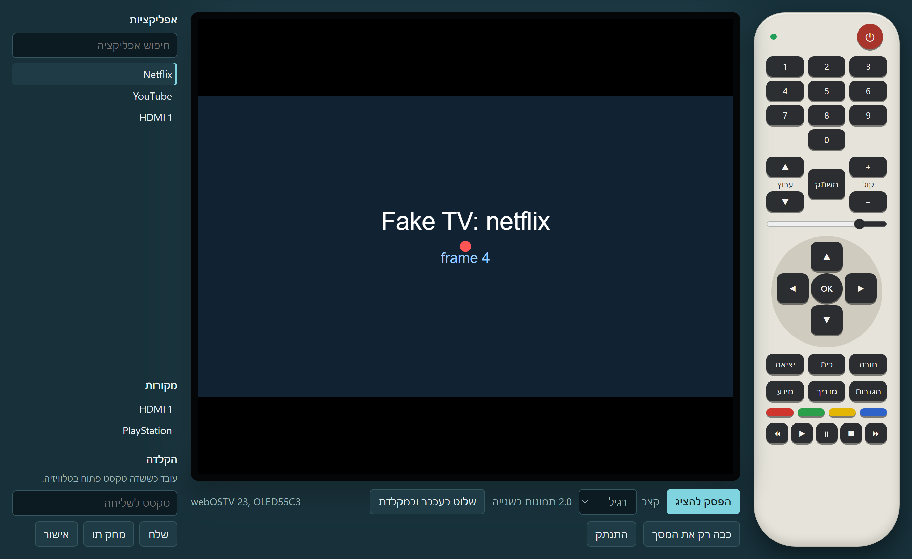
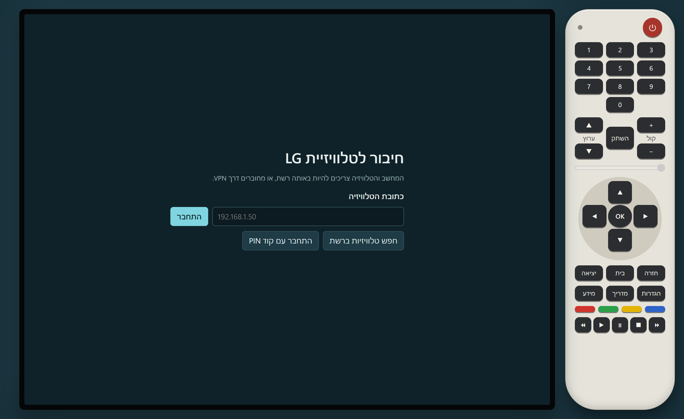
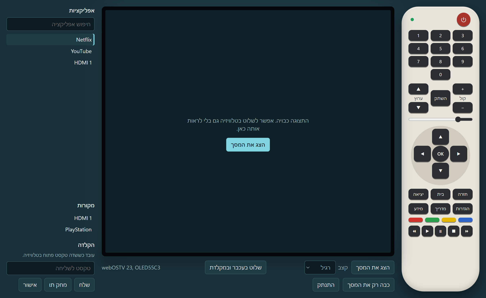

# LG TV Remote

אפליקציית Windows לשליטה בטלוויזיית LG עם webOS מהמחשב: שלט מלא, עכבר, מקלדת, אפליקציות, מקורות, עוצמת קול, וצפייה במסך הטלוויזיה בתוך האפליקציה.



הצילומים כאן מגיעים מטלוויזיה מדומה.

## מה זה נותן, ומה לא

זה קרוב ל-AnyDesk, אבל לא זהה לו:

| יכולת | מצב |
|---|---|
| תצוגת המסך | צילומים חוזרים ב-960×540, כ-3 תמונות בשנייה. בלי קול |
| שליטה | כל כפתורי השלט, סמן עכבר, גלילה והקלדה |
| לחיצה על נקודה בתמונה | לא קיים: הסמן זז רק יחסית למיקומו, כמו בעכבר רגיל |
| התקנה על הטלוויזיה | לא צריך, ולא צריך Developer Mode או root |

פירוט טכני נמצא ב-[איך זה עובד](docs/HOW-IT-WORKS.md).

## התקנה

### קובץ מוכן

1. הורד את `LG TV Remote 0.1.1.exe` מדף [Releases](../../releases/latest).
2. הפעל אותו. לא צריך התקנה.

הקובץ לא חתום, ולכן Windows עלול להציג אזהרה. כדי להמשיך, לחץ "מידע נוסף" ואז "הפעל בכל זאת".

### מהקוד

צריך [Node.js](https://nodejs.org).

```bash
npm install
```

```bash
npm start
```

אם האפליקציה מדווחת ש-Electron לא הותקן כראוי (קרה עם Node 26), פרוס את `electron-v33.4.11-win32-x64.zip` מ-`%LOCALAPPDATA%\electron\Cache` אל `node_modules\electron\dist`, וצור קובץ `node_modules\electron\path.txt` שתוכנו `electron.exe`.

## חיבור בפעם הראשונה



1. ודא שהטלוויזיה דלוקה ובאותה רשת של המחשב.
2. לחץ "חפש טלוויזיות ברשת", או כתוב את הכתובת שלה. אפשר למצוא אותה בהגדרות הרשת של הטלוויזיה.
3. לחץ "התחבר".
4. אשר את הבקשה על מסך הטלוויזיה בעזרת השלט הרגיל.

מהפעם הבאה החיבור לא דורש אישור. אם לא מופיעה בקשה, נסה "התחבר עם קוד PIN".

מומלץ לקבוע לטלוויזיה כתובת IP קבועה בראוטר, כדי שהכתובת השמורה תמשיך לעבוד.

## שימוש



### השלט

השלט בצד פועל כמו שלט רגיל. כפתור ההפעלה מכבה את הטלוויזיה. אם האפליקציה מנותקת, הוא מנסה להדליק אותה.

הנקודה למעלה בשלט מציגה את מצב החיבור:

- **ירוק:** מחובר.
- **צהוב:** מתחבר או מחכה לאישור.
- **אפור:** מנותק.

אם החיבור נופל, האפליקציה מנסה להתחבר מחדש לבד.

### צפייה במסך

"הצג את המסך" מפעיל את התצוגה. אפשר לבחור קצב: מהיר, רגיל או חסכוני. ליד הבחירה מוצג הקצב בפועל.

### עכבר ומקלדת

"שלוט בעכבר ובמקלדת", או קליק על התמונה, תופס את העכבר עד שתלחץ Esc.

| במחשב | בטלוויזיה |
|---|---|
| הזזת העכבר | הזזת הסמן |
| קליק שמאלי | לחיצה |
| קליק ימני | חזרה |
| גלגלת | גלילה |
| חיצים ו-Enter | ניווט ואישור |
| Backspace | מחיקת תו |
| הקלדת אותיות | הקלדה בשדה טקסט פתוח |
| Esc | שחרור העכבר במחשב |

### אפליקציות, מקורות והקלדה

- **אפליקציות:** לחיצה פותחת את האפליקציה. אפשר לסנן לפי שם.
- **מקורות:** מעבר בין כניסות HDMI.
- **הקלדה:** שליחת טקסט שלם, כולל עברית, כשפתוח שדה טקסט בטלוויזיה.

"כבה רק את המסך" מכבה את התמונה בלי לכבות את הטלוויזיה.

## הדלקה דרך הרשת

ההדלקה עובדת רק אחרי חיבור אחד לפחות, שבו האפליקציה לומדת את כתובת ה-MAC, ורק מאותה רשת ביתית. בטלוויזיה צריך להפעיל את "הפעלה דרך Wi-Fi" או "LG Connect Apps" (השם משתנה לפי דגם).

## שליטה מרחוק דרך האינטרנט

**אל תפתח את פורטים 3000 ו-3001 בראוטר.** הטלוויזיה לא בנויה לחשיפה לאינטרנט.

השתמש ב-VPN, למשל Tailscale:

1. התקן Tailscale על מחשב שנשאר דלוק בבית ועל המחשב המרוחק.
2. במחשב הביתי פרסם נתיב לכתובת הטלוויזיה (החלף לכתובת שלך):

```bash
tailscale up --advertise-routes=192.168.1.50/32
```

3. אשר את הנתיב בלוח הניהול של Tailscale.
4. הזן באפליקציה את הכתובת הביתית של הטלוויזיה.

מרחוק לא יעבדו חיפוש טלוויזיות והדלקה דרך הרשת, כי שניהם שידורי רשת מקומית. המסלול הזה עוד לא נבדק בפועל.

## מה נבדק

נבדק על **LG OLED55C6** (`OLED55C66LA`) ברשת ביתית:

| נבדק ועבד | עוד לא נבדק על טלוויזיה אמיתית |
|---|---|
| צימוד באישור על המסך | צימוד בקוד PIN |
| רשימת 43 אפליקציות ו-4 מקורות | פתיחת אפליקציה והחלפת מקור |
| קריאת עוצמת הקול | שינוי עוצמת הקול והשתקה |
| תצוגת שידור חי ב-960×540, כ-3.2–3.5 תמונות בשנייה | תוכן מוגן כמו Netflix, עלול להופיע שחור |
| כפתורי השלט (`INFO`, `BACK`) | תנועת עכבר, קליק וגלילה |
| חיבור חוזר בלי אישור נוסף | הקלדה, כיבוי, הדלקה, VPN |

בנוסף, כל הפונקציות נבדקו מול טלוויזיה מדומה:

```bash
npm test
```

```bash
npm run test:e2e
```

אפשר גם לנסות את הממשק בלי טלוויזיה:

```bash
npm run start:fake
```

בדיקה מול טלוויזיה אמיתית (קריאה בלבד, בלי לחיצות):

```bash
node tests/real-tv-check.js 192.168.1.50
```

## פתרון בעיות

| הבעיה | מה לעשות |
|---|---|
| "לא הצלחתי להגיע לטלוויזיה" | בדוק שהיא דלוקה ושהכתובת נכונה |
| הבקשה לא מופיעה על המסך | נסה "התחבר עם קוד PIN" |
| "הטלוויזיה הזו חוסמת צילום מסך" | השליטה ממשיכה לעבוד. אפשר לנסות לשכוח את הטלוויזיה ולחבר מחדש |
| התמונה שחורה | כנראה תוכן מוגן |
| ההקלדה לא עושה כלום | צריך קודם לפתוח שדה טקסט בטלוויזיה |

## פרטיות ואבטחה

- האפליקציה מדברת ישירות עם הטלוויזיה, בלי שרת חיצוני.
- מפתח החיבור נשמר מוצפן במחשב שלך (Windows DPAPI).
- לביטול הגישה: לחץ "שכח" באפליקציה. כדאי גם למחוק את האפליקציה מרשימת המכשירים המחוברים בהגדרות הטלוויזיה, אם קיימת כזו.
