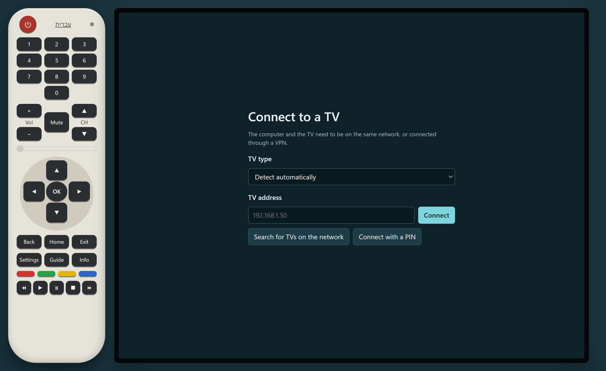
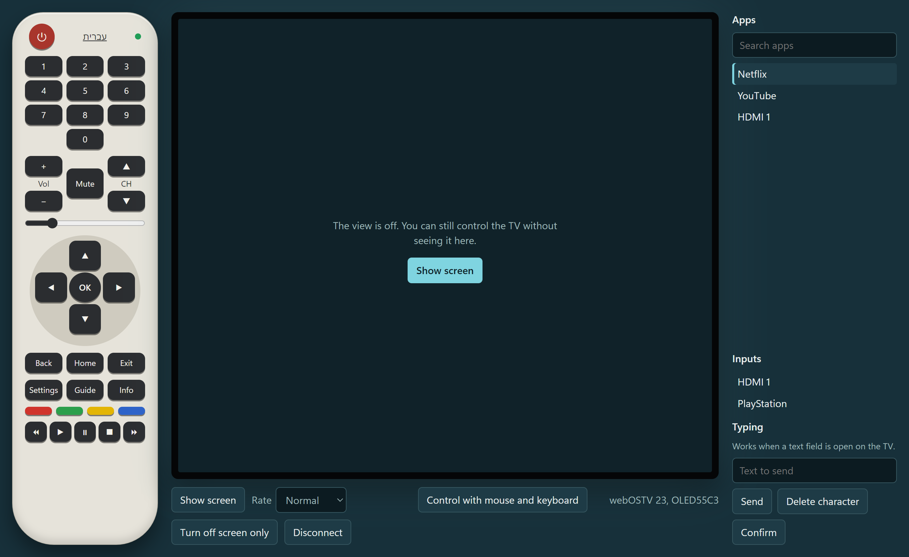
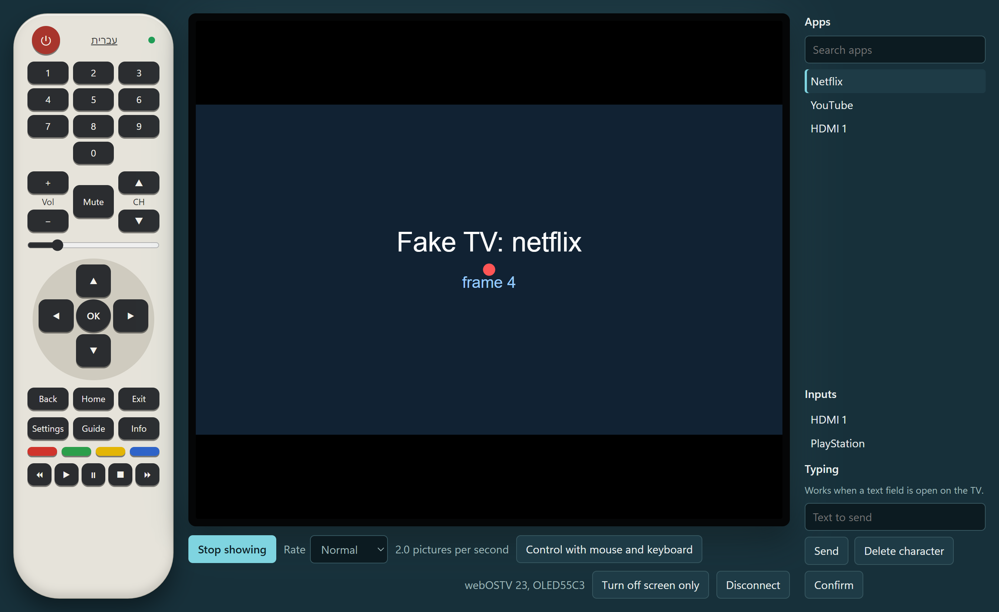

# Universal TV Remote

**English** | [עברית](README.he.md)

A Windows desktop app that controls your smart TV from your computer: LG, Samsung, Android TV and Google TV (Sony, Philips, TCL, Xiaomi and others), Roku, Vizio and Sony BRAVIA. It offers an on-screen remote, apps, inputs, typing and volume. On LG TVs it also shows the TV's screen in the app and controls a mouse pointer.

> **Only LG has been tested on a real TV.** The other brands are written from their published protocols and tested against simulators, so they may need fixes on a real set. See [Which TVs work](#which-tvs-work).


*The app, with its Hebrew interface, showing the home screen of a real LG OLED55C6.*

Nothing is installed on the TV. Developer Mode and root are not needed.

The app is available in English and Hebrew. The technical details are in [How it works](docs/HOW-IT-WORKS.en.md).

## Contents

- [Quick install](#quick-install)
- [Which TVs work](#which-tvs-work)
- [What it can and cannot do on LG](#what-it-can-and-cannot-do-on-lg)
- [Requirements](#requirements)
- [Installation](#installation)
- [Connecting for the first time](#connecting-for-the-first-time)
- [Choosing a language](#choosing-a-language)
- [Using the app](#using-the-app)
- [Turning the TV on over the network](#turning-the-tv-on-over-the-network)
- [Control from outside your home](#control-from-outside-your-home)
- [What has been tested](#what-has-been-tested)
- [Troubleshooting](#troubleshooting)
- [FAQ](#faq)
- [Privacy and security](#privacy-and-security)
- [Development](#development)

## Quick install

Run this in PowerShell:

```powershell
irm https://raw.githubusercontent.com/dor2500/universal-tv-remote/main/install.ps1 | iex
```

This installs the latest version for your user, adds a Start menu shortcut and opens the app. Administrator rights are not needed.

## Which TVs work

No app can control every TV over a network. The app works with the platforms below, and it shows only the buttons and panels that your TV supports.

| | LG webOS | Samsung Tizen | Android TV / Google TV | Roku | Vizio SmartCast | Sony BRAVIA (key) |
|---|---|---|---|---|---|---|
| Sold by, for example | LG | Samsung, 2016 and later | Sony, Philips, TCL, Hisense, Xiaomi | TCL, Hisense, Sharp, Roku players | Vizio | Sony |
| First connection | Approve on the TV | Approve on the TV | Type the code from the TV | Nothing | Type the code from the TV | Set a key on the TV and type it |
| Remote buttons | All | All | Most | No digits or colors | No digits or colors | Those the TV reports |
| Apps | Installed list | Installed list | 7 common apps | Installed list | No | Installed list |
| Inputs | Yes | HDMI 1–4 | HDMI 1–4 | On Roku TVs | Yes | Yes |
| Typing | Yes | Yes | Yes | Yes, one letter at a time | No | Yes |
| Volume slider | Yes | No, + and − only | No, + and − only | No, + and − only | Yes | Yes |
| Turn off | Yes | Yes | Yes (power toggle) | On Roku TVs | Yes | Yes |
| **Screen view in the app** | **Yes** | No | No | No | No | No |
| **Mouse pointer** | **Yes** | No | No | No | No | No |
| Tested on a real TV | **Yes, one model** | No | No | No | No | No |

**Not supported:**

- **TVs with no network connection:** nothing on the computer can reach them. They would need extra hardware, such as an infrared transmitter, which this app doesn't support.
- **Other platforms:** Samsung TVs from before 2016, Hisense VIDAA, Panasonic, Fire TV, Philips TVs without Android, and others. The app reports that it found no supported TV.

**Why only LG shows the screen:** webOS has a screenshot command that works without changing anything on the TV. The other platforms don't offer one in these protocols.

## What it can and cannot do on LG

On LG the app comes close to AnyDesk, but webOS sets real limits.

| Feature | Status |
|---|---|
| All remote buttons | Yes |
| Mouse pointer, click and scroll on the TV | Yes |
| Typing into an open text field, including Hebrew | Yes |
| Opening apps and switching inputs | Yes |
| Volume, mute, turning the TV off, turning only the screen off | Yes |
| Turning the TV on | Only from your home network, after enabling a TV setting |
| Viewing the screen | Yes, as repeated screenshots at 960×540, about 3 per second |
| Smooth live video | No: webOS offers screenshots, not a video stream |
| Sound on the computer | No |
| Clicking an exact spot in the picture | No: the TV only accepts relative pointer movement |
| Protected content such as Netflix | May appear black (not yet tested) |

LG does not officially document the protocol this app uses, so a firmware update could change how it behaves.

## Requirements

- Windows 10 or 11, 64-bit.
- A TV from [the supported list](#which-tvs-work).
- The computer and the TV on the same network, or connected through a VPN.
- Access to the TV's regular remote for the first pairing. Roku is the exception.

## Installation

### Option 1: PowerShell command (recommended)

```powershell
irm https://raw.githubusercontent.com/dor2500/universal-tv-remote/main/install.ps1 | iex
```

The command:

1. Finds the latest release on GitHub.
2. Downloads the app and checks the file's size and, when GitHub provides one, its checksum.
3. Saves it to `%LOCALAPPDATA%\Programs\Universal TV Remote`.
4. Adds an "LG TV Remote" shortcut to the Start menu.
5. Opens the app.

Run the same command again to update. Close the app first. It also replaces a version installed under the old name, LG TV Remote, and keeps your saved TVs. You can [read the script](install.ps1) before running it.

### Option 2: Download the file

1. Open the [latest release](https://github.com/dor2500/universal-tv-remote/releases/latest).
2. Download `Universal.TV.Remote.0.2.0.exe`.
3. Run it. It does not need installing.

The file is not code-signed, so Windows may show a warning. To continue, select **More info**, then **Run anyway**.

### Option 3: Run from source

You need [Node.js](https://nodejs.org) and [Git](https://git-scm.com).

```bash
git clone https://github.com/dor2500/universal-tv-remote.git
```

```bash
cd universal-tv-remote
```

```bash
npm install
```

```bash
npm start
```

If the app says Electron was not installed correctly (this happened on Node 26):

1. Unpack `electron-v33.4.11-win32-x64.zip` from `%LOCALAPPDATA%\electron\Cache` into `node_modules\electron\dist`.
2. Create `node_modules\electron\path.txt` containing only `electron.exe`.

### Uninstalling

This removes the app installed with the PowerShell command:

```powershell
Remove-Item -Recurse "$env:LOCALAPPDATA\Programs\Universal TV Remote"; Remove-Item "$([Environment]::GetFolderPath('Programs'))\Universal TV Remote.lnk"
```

To also remove saved TVs and pairing keys, delete `%APPDATA%\universal-tv-remote`. If you first installed a version called LG TV Remote, your data is in `%APPDATA%\lg-tv-remote` instead.

## Connecting for the first time



1. Turn on the TV and make sure it is on the same network as the computer.
2. Open the app.
3. Select **Search for TVs on the network** and choose your TV. Alternatively, type its IP address and select **Connect**. **TV type** can stay on **Detect automatically**.
4. Complete the first connection for your TV, as listed below. You have 90 seconds.
5. The remote lights up with a green dot, and the app lists what your TV offers.

| TV | First connection |
|---|---|
| LG, Samsung | Accept the request on the TV screen with the TV's remote |
| Android TV, Google TV | The TV shows a 6-character code. Type it in the app |
| Vizio | The TV shows a code. Type it in the app |
| Roku | Nothing to approve. If control is refused, enable **Settings > System > Advanced system settings > Control by mobile apps** |
| Sony BRAVIA, as **Sony BRAVIA (with a key)** | On the TV, open **Settings > Network > Home network > IP control**, set authentication to **Normal and Pre-Shared Key**, choose a key and type it in the app. The menu varies by model |

A Sony TV with Android is detected as Android TV, which needs no setup. Choose **Sony BRAVIA (with a key)** by hand to get its installed apps and volume slider instead.

Later connections don't need approval.

**Finding the TV's address:** open the network settings on the TV and look for the IP address. The exact menu varies by model.

**Keep the address stable:** reserve a fixed IP for the TV in your router. Otherwise the saved address can stop working when the router assigns a new one.

**If no request appears on an LG TV:** select **Connect with a PIN** and type the code shown on the TV.

## Choosing a language

The app starts in Hebrew if Windows is set to Hebrew, and in English otherwise. To switch, select the language name at the top of the on-screen remote. The app remembers your choice, and the layout flips to match the language.

Messages written by the TV itself are shown as the TV sends them.

## Using the app



*This picture and the one below use a simulated TV.*

### The remote

The table lists every button. Your TV may show fewer.

| Button | What it does |
|---|---|
| Red power button | Turns the TV off. When disconnected, tries to turn it on |
| 0–9 | Number keys |
| Vol + / − | Volume up and down |
| CH ▲ / ▼ | Next and previous channel |
| Mute | Mute and unmute |
| Slider | Sets the volume directly |
| Arrows and OK | Navigation |
| Back | Back |
| Home | Home screen |
| Exit | Exit |
| Settings | Quick settings |
| Guide | Programme guide |
| Info | Info |
| Colored buttons | Red, green, yellow and blue keys |
| Bottom row | Rewind, play, pause, stop, fast forward |

Buttons act on whatever is on the TV at that moment, and each app decides how to respond to them.

The dot at the top of the remote shows the connection:

- **Green:** connected.
- **Yellow:** connecting, reconnecting or waiting for approval.
- **Gray:** disconnected.

If the connection drops, the app keeps trying to reconnect, waiting up to 30 seconds between attempts.

### Viewing the screen

LG TVs only.



Select **Show screen** to start, and **Stop showing** to stop. The **Rate** menu has three options:

| Option | Time between captures |
|---|---|
| Fast | 250 ms |
| Normal | 500 ms |
| Economy | 1.5 s |

The actual rate appears next to the menu. It can't exceed what the TV delivers: about 3–4 pictures per second on the tested TV.

The original picture from the TV looks like this:


### Mouse and keyboard

LG TVs only. On other TVs, use the arrows and the typing panel.

Select **Control with mouse and keyboard**, or click the picture. The app then captures your mouse until you press Esc.

| On your computer | On the TV |
|---|---|
| Move the mouse | Moves the pointer |
| Left click | Click |
| Right click | Back |
| Mouse wheel | Scroll |
| Arrow keys | Navigation |
| Enter | OK |
| Backspace | Delete a character |
| Letters and numbers | Type into an open text field |
| Esc | Releases your mouse |

**The white pointer over the picture is an estimate.** The TV leaves its own pointer out of screenshots and doesn't report where it is, so the app calculates the position and draws its own.

- **Each capture starts from a corner:** the TV's pointer jumps to the top-left corner, which gives the app a known starting point.
- **The highlighted item is the true position:** if the two disagree, trust what the TV highlights.
- **To correct drift:** press Esc and capture again, or move the pointer into a screen edge.

### Apps, inputs and text

The side panel appears once you are connected.

- **Apps:** select an app to open it. The filter box searches by name, and the running app is marked.
- **Inputs:** switch between HDMI and other inputs.
- **Typing:** send a whole line of text, delete a character, or confirm. A text field must already be open on the TV.

### Other controls

- **Turn off screen only** turns off the picture while the TV stays on, for example when listening to music. **Turn on screen** turns it back on.
- **Disconnect** disconnects.
- **Forget**, next to a saved TV on the connection screen, deletes that TV and its pairing key from the computer.

## Turning the TV on over the network

The power button can wake the TV with a Wake-on-LAN packet, on TVs that report their MAC address: LG, Samsung, Roku and Sony in the app's tests. This needs three things:

1. One successful connection, so the app has learned the TV's MAC address.
2. The setting enabled on the TV. On LG it is usually called "Turn on via Wi-Fi" or "LG Connect Apps". The name varies by brand and model.
3. The computer on the same home network as the TV.

This has not yet been tested on a real TV.

## Control from outside your home

**Do not forward your TV's ports on your router.** The TV isn't built to be exposed to the internet, and doing so could let others reach it.

Use a VPN instead. Here's the approach with [Tailscale](https://tailscale.com), which needs a computer that stays on at home. This path has not yet been tested.

1. Install Tailscale on the home computer and on the remote computer, using the same account.
2. On the home computer, advertise a route to the TV, replacing the address with your TV's:

   ```bash
   tailscale up --advertise-routes=192.168.1.50/32
   ```

3. Approve the route in the Tailscale admin console.
4. On the remote computer, type the TV's home address into the app.

From outside your home:

- **Network search doesn't work:** type the address by hand.
- **Turning the TV on doesn't work:** the TV must already be on, because Wake-on-LAN only works on the local network.
- **Overlapping networks can conflict:** if the remote network uses the same address range as your home network, the TV's address may not be reachable.

## What has been tested

Only one real TV has been tried: an **LG OLED55C6** (`OLED55C66LA`) on a home network. **Samsung, Android TV, Google TV, Roku, Vizio and Sony have not been tried on any real TV.** They pass automated tests against simulators written from open-source clients and vendor documentation, so a real set may behave differently.

On the OLED55C6:

| Worked on the real TV | Not yet tested on a real TV |
|---|---|
| Pairing by on-screen approval | Pairing by PIN |
| Reconnecting without new approval | Choosing a found TV from the list |
| Automatic detection as LG, and network search finding it | |
| Listing 43 apps and 4 inputs | Opening apps and switching inputs |
| Reading the volume | Changing the volume and muting |
| Viewing live TV at 960×540, about 3–4 pictures per second | Protected content such as Netflix |
| Remote buttons (`INFO`, `BACK`, `HOME`) | Click and scroll |
| Pointer movement, and the estimated pointer at slow and medium speed | Pointer accuracy at high speed |
| | Typing, turning off, turning on, VPN |

On this TV, LG blocks the older public signature that open-source clients send. The app detects that and pairs without it. Without the signature, the TV may grant fewer permissions, so some untested features might be refused.

Those tests prove the app's logic, not how a real TV responds. Other LG models and webOS versions have not been tried.

## Troubleshooting

| Problem | What to do |
|---|---|
| "Can't reach the TV" | Check that the TV is on and the address is correct, and that the computer is on the same network |
| Network search finds nothing | Type the address by hand. Some networks and firewalls block device discovery |
| "No supported TV answered" | Check that the TV is on. Choose the type by hand. Your TV may not be [supported](#which-tvs-work) |
| No request appears on an LG TV | Try connecting with a PIN |
| "Network control is turned off" on a Roku | Enable **Control by mobile apps** in its settings |
| The code isn't accepted | Type it again exactly as shown. A Sony key must match the one set on the TV |
| An Android TV app doesn't open | It may not be installed. The app can't see what is installed |
| Buttons are missing | Your TV's protocol doesn't offer them |
| Pairing times out | Connect again and accept the request within 90 seconds |
| The TV keeps asking for approval | Remove the app from the TV's connected devices, if listed, select **Forget** and pair again |
| "This TV blocks screenshots" | Control keeps working. Try selecting **Forget** and pairing again. Your TV may not allow screenshots |
| The picture is black | This is probably protected content |
| The picture is slow | Choose the fast rate. The TV limits the maximum rate |
| The white pointer doesn't match the TV | Press Esc and capture again. Trust the item the TV highlights |
| Typing does nothing | Open a text field on the TV first |
| Mouse is stuck in the app | Press Esc |
| The power button doesn't turn the TV on | See [Turning the TV on over the network](#turning-the-tv-on-over-the-network) |
| Installer says the app is running | Close the app and run the command again |
| Windows warns about the file | The file isn't code-signed. Select **More info**, then **Run anyway** |

## FAQ

**Does this need root or Developer Mode?**
No.

**Does anything get installed on the TV?**
No. The app uses the network interface already built into the TV.

**Can I hear the TV's sound on my computer?**
No. These interfaces don't offer it.

**Why isn't the picture smooth video?**
A TV without root offers screenshots only, and one has to be requested each time.

**Will this work on my TV?**
Check [the list](#which-tvs-work). Only the LG OLED55C6 has been tested. Other TVs may behave differently, and may need fixes.

**Does it work with every TV?**
No. A TV needs a supported platform and a network connection.

**Why can't I see the screen of my Samsung or Android TV?**
Those protocols have no screenshot command, and this app doesn't change anything on the TV.

**Can it work with a Mac or Linux?**
Only Windows builds are provided and tested.

**Can someone else on my network take over my TV?**
On most TVs, not through this app without approval on the TV. Roku is the exception: it has no pairing, so anyone on your network can send it commands if **Control by mobile apps** allows it.

## Privacy and security

- The app talks directly to your TV. It has no server, account or telemetry.
- Pairing keys are encrypted on your computer with Windows DPAPI. That includes the Android TV certificate and the Sony key.
- Anyone holding that key on your network could control the TV, so only install the app on computers you trust.
- The TV uses a self-signed certificate that can't be verified, so the connection is encrypted but the TV's identity isn't checked. Use it on a network you trust.
- To revoke access, select **Forget** in the app, and remove the app from the TV's connected devices, if your TV lists them.

## Development

```bash
npm test
```

Protocol tests against simulated TVs of every brand.

```bash
npm run test:e2e
```

Drives the real app against the simulated LG TV.

```bash
npm run test:brands
```

Drives the real app against the other simulated brands.

```bash
npm run start:fake
```

Opens the app with a simulated LG TV, so you can try it without one. Type `127.0.0.1` as the address.

```bash
npm run dist
```

Builds the Windows executable into `dist`.

```bash
node tests/real-tv-check.js 192.168.1.50
```

Pairs with a real TV, reads its information and measures screenshots, without pressing any buttons. Images are saved to `tests/output`, which Git ignores. They may show what is on your TV, so review them before sharing.

See [How it works](docs/HOW-IT-WORKS.en.md) for the architecture, protocol and code layout.

This repository has no license file yet, so by default the code can be viewed but not reused.
